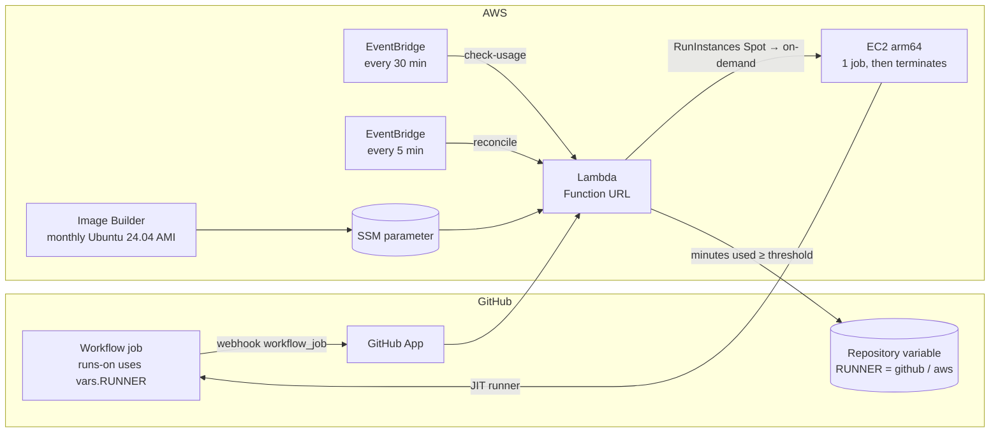

# cdk-github-runner-switch

[Leia em português](README.pt-BR.md)

An AWS CDK construct for teams on GitHub's free Actions minutes. It keeps your workflows on **GitHub-hosted runners
while the free minutes last**. When the monthly minutes run out, it **switches automatically to disposable EC2 Spot
machines (Graviton, arm64) in your AWS account**. On the 1st of the next month it switches back.

There is nothing to remember and no blocked pipeline at the end of the month. You don't pay for idle machines.



## Why

- **The free plan is enough most of the month.** Paying for runners all the time is a waste, and so is a blocked
  pipeline on the 25th.
- **Self-hosted runners usually stay on all the time, or need a lot of moving parts.** Here each job gets a fresh
  machine with a single-use runner registration ([JIT](https://docs.github.com/en/actions/hosting-your-own-runners/managing-self-hosted-runners/autoscaling-with-self-hosted-runners#using-just-in-time-runners)).
  The machine terminates when the job ends.
- **The switch is a repository variable.** Workflows choose the runner with one expression. There is no
  fork of your workflows and no manual step.

## What you get

| Piece | What it does |
|---|---|
| Webhook (Lambda Function URL) | Checks the GitHub signature. Each queued job that asks for the AWS label gets one machine: Spot on every instance type × subnet first, then on-demand. |
| Switch (every 30 min) | Reads the Actions minutes used this month and flips `RUNNER` to `aws` at the threshold (default 1,900 of 2,000). It flips back to `github` when the month resets. When it moves to AWS, it re-runs the runs that failed because the minutes ran out. |
| Reconciliation (every 5 min) | Queued jobs without a machine get one. This covers a lost webhook and jobs that hit the machine cap. |
| On-demand label | Jobs labeled `aws-ondemand` (for example, deploys) skip Spot, so an interruption never cuts a deploy in half. |
| Runner image | Ubuntu 24.04 arm64 from Canonical with Docker, Node.js, Python, git, GitHub CLI, AWS CLI and the runner. EC2 Image Builder rebuilds it monthly. You can add cached container images and extra commands. |
| Safety | Security group with no inbound rules, IMDSv2, encrypted disk, shutdown → terminate, a 2-hour guard against hung jobs. The function may only launch, tag and list instances. |

## Quick start

```bash
npm install cdk-github-runner-switch
```

```ts
import { GitHubRunnerSwitch } from 'cdk-github-runner-switch';

const vpc = new ec2.Vpc(stack, 'Vpc', { natGateways: 0, subnetConfiguration: [{ name: 'public', subnetType: ec2.SubnetType.PUBLIC }] });
const runners = new GitHubRunnerSwitch(stack, 'Runners', { vpc, repository: 'my-org/my-repo' });
new CfnOutput(stack, 'WebhookUrl', { value: runners.webhookUrl });
new CfnOutput(stack, 'SecretArn', { value: runners.secret.secretArn });
new CfnOutput(stack, 'ImagePipelineArn', { value: runners.imagePipelineArn });
```

Then, once per account and repository:

1. **Spot service-linked role** (only if the account has never used Spot):
   `aws iam create-service-linked-role --aws-service-name spot.amazonaws.com`
2. **Deploy** the stack (`cdk deploy`).
3. **Build the first image** (about 30 minutes). After that, it is rebuilt on schedule:
   `aws imagebuilder start-image-pipeline-execution --image-pipeline-arn <ImagePipelineArn>`
4. **Create the GitHub App and store its key.** Run [`scripts/setup-github-app.sh <stack-name>`](scripts/setup-github-app.sh)
   in your terminal. It prints the webhook URL, the generated webhook secret and the permissions to grant. Then it
   asks for the App ID and the `.pem` file. The key goes straight to Secrets Manager.
5. **Point the workflows at the switch:**

   ```yaml
   runs-on: ${{ vars.RUNNER == 'aws' && fromJSON('["self-hosted","linux","arm64","aws"]') || 'ubuntu-24.04-arm' }}
   ```

   See [`examples/workflow.yml`](examples/workflow.yml) (with an on-demand deploy job) and
   [`examples/canary.yml`](examples/canary.yml), a weekly liveness test that uses no GitHub minutes.

To flip the switch by hand: `gh variable set RUNNER --body aws` (or `github`).

## Configuration

| Property | Default | Notes |
|---|---|---|
| `vpc` | (required) | Machines need outbound internet access. |
| `subnets` | public subnets | Public subnets avoid paying for a NAT gateway. The machines still have no inbound port. |
| `repository` | (required) | `owner/name`. |
| `billing` | `ORGANIZATION` | `USER` for personal accounts. That needs a fine-grained token with *Plan: read*, which the setup script stores as `billingToken`. |
| `label` / `onDemandLabel` | `aws` / `aws-ondemand` | Labels used in `runs-on`. |
| `instanceTypes` | `m7g.large`, `m6g.large`, `m8g.large` | Graviton (arm64), in order of preference. |
| `thresholdMinutes` | `1900` | When to move to AWS. Set it a little below your plan's quota. |
| `maxInstances` | `6` | Machine cap. Jobs above it wait and are launched by the reconciliation. |
| `switchVariable` | `RUNNER` | Repository variable that the construct flips. |
| `maxJobDuration` | 2 hours | The machine shuts down after this, even if a job hangs. |
| `rootVolumeSize` | `40` GiB | |
| `nodeMajorVersion` | `24` | Node.js installed in the image. |
| `cachedImages` | `[]` | Container images pulled into the AMI, for faster `services:`. |
| `extraImageCommands` | `[]` | Extra setup, e.g. `npx -y playwright install-deps chromium`. |
| `secret` | new secret | Reuse an existing secret with `webhookSecret`, `appId` and `privateKey` (e.g. when migrating). |
| `imageSchedule` | monthly (day 1, 05:00 UTC) | EventBridge cron for the image rebuild. |
| `reconcileInterval` / `usageCheckInterval` | 5 min / 30 min | |

## Cost

You pay only while jobs run:

- the EC2 Spot price of the instance;
- a few cents of Lambda, EventBridge and Secrets Manager;
- the storage of one AMI snapshot;
- one monthly image build (about 30 minutes of a `large` instance).

There is no NAT gateway, no load balancer and no machine waiting for work. Check the Spot prices in your region; for
`m7g.large` they are usually a fraction of the on-demand price.

## Security notes

- The webhook is a public Function URL. Every request is authenticated with the App's HMAC signature
  (`X-Hub-Signature-256`). Requests without a valid signature get 401.
- The GitHub App only needs: repository *Administration* (to create JIT runners), *Actions* (read runs and re-run
  failed ones), *Variables* (the switch), and organization *Administration: read* (billing usage).
- The machine role only has Session Manager access, for debugging. Give your jobs their own credentials, for
  example with GitHub OIDC.
- One machine per job, never reused. A job cannot see another job's workspace.

## Limitations

- arm64 (Graviton) only, for now. Your workflows need arm64-compatible actions and images.
- One repository per construct. Instantiate it again for other repositories.
- Linux only.

## Prior art

[github-aws-runners/terraform-aws-github-runner](https://github.com/github-aws-runners/terraform-aws-github-runner) (formerly philips-labs) and
[CloudSnorkel/cdk-github-runners](https://github.com/CloudSnorkel/cdk-github-runners) are mature, feature-rich
projects for running GitHub runners on AWS. This construct does something narrower: it **uses GitHub's free minutes
first and only spills over to AWS when they run out**, with as few moving parts as possible.

## License

[Apache-2.0](LICENSE)
